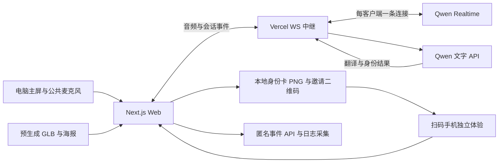

# 黄泉议会万圣节派对实施计划

对应：[产品规范 v1.0](spec.md)；执行入口：[任务清单](tasks.md)。本文保留最终目标架构，实际已实现范围与差异见 [进展](../../docs/progress.md)及 ADR；T11 以后的目录和能力仍是规划。

## 1. 技术选择

| 层次 | 首版选择 | 职责 |
| --- | --- | --- |
| 语言与工程 | TypeScript、pnpm workspace | 一个 Web 应用；仅抽 contracts 和纯流程核心两个包 |
| Web | Next.js App Router、React、普通 CSS | 手机入口、角色选择、主屏、结果和服务端路由；当前界面沿用已有 CSS |
| 状态 | VoiceClient＋React、纯 TypeScript 流程函数 | 浏览器会话状态、恢复与去重；当前不引入 Zustand |
| 3D | Three.js、React Three Fiber、Drei | 加载预生成 GLB、灯光、角色动作和实际播放音量驱动嘴部 |
| 实时语音 | `qwen-audio-3.1-realtime-plus`，原生 WS 协议 | 每个浏览器当前角色一个上游会话 |
| 翻译与结果 | 千问文字 API，默认 `qwen3.6-flash` | 异步字幕翻译、双语身份结果；真实账号需单独验证可调用 |
| 中继 | Vercel Node.js Functions、`ws`、`@vercel/functions` | 服务端鉴权、协议转换、上下游流量与关闭管理 |
| 角色资产 | 腾讯混元生成后导出 GLB | 离线制作与检查；游戏运行时只读取静态资产 |
| 卡片与二维码 | 浏览器 Canvas、`qrcode` | 模板化 PNG 与邀请链接；无逐用户图像生成 |
| 部署 | Vercel＋Cloudflare DNS | HTTPS、静态资产、服务端配置、正式域名 |
| 验证 | Vitest、Playwright、GitHub Actions、自有 eval runner | 确定性检查与真实语音／主观内容评估分别进行 |

Next.js、React、R3F 及其他依赖在初始化时锁定互相兼容的稳定版本，提交锁文件。Vercel 接入的最低要求采用当前官方文档：`@vercel/functions >=3.10.0` 的 `upgradeWebSocket`，开发 WS 使用 Vercel CLI `>=54.14.2` 的 `vc dev`；`next dev` 仅用于无需升级 WS 的界面工作。若开启 Cache Components，路由应按官方示例在升级前调用 `connection()`。最终仍需 Vercel 预览部署端到端验证。[Vercel API](https://vercel.com/docs/functions/functions-api-reference/vercel-functions-package#upgradewebsocket)。

`qwen3.6-flash` 在官方文字模型列表中支持结构化输出；本项目用它处理短字幕与结果，默认关闭可关闭的思考过程，限制输入与输出长度。服务地址采用该账号所属平台官方兼容端点，不复用旧平台域名猜测配置。[模型能力](https://platform.qianwenai.com/docs/developer-guides/getting-started/text-generation-models)、[文字 API](https://platform.qianwenai.com/docs/api-reference/chat/openai-chat)。

## 2. 系统边界



- 主屏与手机共享应用和配置，各自独立运行，不共享内存会话或房间。
- 浏览器保存流程与最近结果；音频缓冲、麦克风轨道和音频节点仅留在内存。
- WS 连接内可以保存当前上下文、翻译队列与计时器；进程内状态不承担跨连接恢复、全局额度或跨用户通信。
- 新连接用经过校验的恢复快照重建有限文本上下文，不依赖重连命中原实例。
- 首版无数据库、Redis、Docker、自建推理或自建常驻服务。长效公开卡片页面和跨设备历史不进入本版。

## 3. 待创建目录

```text
Nether-Council/
├── AGENTS.md
├── package.json
├── pnpm-workspace.yaml
├── pnpm-lock.yaml
├── .env.example                     # 仅占位值
├── apps/web/
│   ├── src/app/
│   │   ├── page.tsx                 # 入口、语言、角色
│   │   ├── play/page.tsx            # 手机／普通体验
│   │   ├── host/page.tsx            # 主持模式
│   │   ├── result/page.tsx          # 读取本机最近结果
│   │   └── api/
│   │       ├── sessions/route.ts    # 会话票据
│   │       ├── ws/route.ts          # WS 中继
│   │       ├── referrals/route.ts   # 匿名邀请标识
│   │       └── events/route.ts      # 白名单埋点
│   ├── src/features/
│   │   ├── lobby/                  # 入场、设备检查、选择角色
│   │   ├── party/                  # 流程编排与主持控制
│   │   ├── characters/             # 七角色配置与双语人设
│   │   ├── voice/                  # 采集、重采样、播放、厂商适配
│   │   ├── captions/               # 原文分段与异步译文
│   │   ├── world3d/                # 模型、镜头、音量驱动动画
│   │   ├── identity/               # 结果校验、卡片与分享
│   │   └── analytics/              # 事件队列与匿名来源
│   ├── src/shared/                 # UI、i18n、server-only 配置
│   └── public/{models,posters,audio,worklets}/
├── packages/
│   ├── contracts/src/              # TS 类型、Zod 运行时校验
│   └── party-core/src/             # 纯流程、时限、结果去重
├── specs/001-halloween-party/       # spec、plan、tasks
├── tests/{integration,e2e,fixtures}/
├── evals/{datasets,rubrics,runners}/
├── scripts/                        # smoke、压测、日志采集与报告
├── docs/{adr,architecture,runbooks}/
├── .github/workflows/ci.yml
└── artifacts/                      # 本地报告，Git 忽略
```

`app` 只组织路由。业务实现放 `features`；`party-core` 不依赖 React、Three.js 或厂商协议；`contracts` 不依赖应用。厂商事件只在 voice 服务端适配器中出现，业务层消费应用事件。暂不增加包管理工具、通用游戏引擎或空的多层抽象。

## 4. 接口契约

先在 `packages/contracts` 定义运行时 schema，再实现调用方。以下是设计契约，最终导出的类型以 schema 为准。

```ts
type Locale = 'zh' | 'en';
type ExperienceMode = 'personal' | 'host';
type CharacterId =
  | 'hei-wuchang' | 'bai-wuchang' | 'zhong-kui' | 'meng-po'
  | 'frankenstein' | 'werewolf' | 'vampire';

type LocalizedText = { zh: string; en: string };

interface CharacterDefinition {
  id: CharacterId;
  name: LocalizedText;
  introduction: LocalizedText;
  promptVersion: string;
  voiceByLocale: Record<Locale, string>; // 只填已试听的官方 voice ID
  modelUrl: string;
  posterUrl: string;
  cardTheme: string;
}

interface IdentityResult {
  schemaVersion: 1;
  resultId: string;
  sessionId: string;
  characterId: CharacterId;
  locale: Locale;
  title: LocalizedText;
  verdict: LocalizedText;
  warmClosing: LocalizedText;
  tags: { zh: string[]; en: string[] };
  sourceTurnIds: string[]; // 支撑个性化评价的用户话轮
  generatedAt: string;
  fallback: boolean;
}

interface CaptionSegment {
  sessionId: string;
  epoch: number;
  responseId: string;
  segmentId: string;
  revision: number;
  speaker: 'user' | 'character';
  sourceLocale: Locale;
  sourceText: string;
  translatedText?: string;
  final: boolean;
}
```

`resultId`、会话 ID、角色、时间等由应用生成和绑定；LLM 只填写内容字段。标题上限中文 18 字／英文 64 字符，评价中文 60 字／英文 180 字符，暖收尾中文 50 字／英文 160 字符，标签每种语言 2–3 个；超长内容先校验／重写，不在图片里强行缩成小字。`sourceTurnIds` 必须属于本会话已确认的用户话轮。

### HTTP

| 接口 | 输入 | 输出与边界 |
| --- | --- | --- |
| `POST /api/sessions` | 角色、语言、模式、活动 ID、活动入场凭证、可选恢复票据 | 短期签名票据；绑定 sessionId、角色、语言、绝对截止时间与允许能力。浏览器通过短期 HttpOnly cookie 参加同源 WS 握手，密钥不下发 |
| `GET /api/ws` | 同源请求及有效会话 cookie | 鉴权后升级；默认拒绝无票据、跨源、过期、错误角色和异常大小的消息 |
| `POST /api/referrals` | 合法会话标识 | 签名匿名来源 token 与正式域名邀请 URL；邀请不是上游 API 凭据 |
| `POST /api/events` | 白名单事件批次 | 校验、去重字段、输出结构化日志；不接受对话正文或任意属性 |

同浏览器其他标签页共享 cookie 时，握手后首条 `session.start` 必须带预期 sessionId 并与票据匹配；不匹配则关闭，不能误接到另一标签页角色。匿名票据提供调用范围约束，不等于可靠的每人限额或一次性消费机制。

### 应用 WS 事件

- 客户端：`session.start`、`audio.append`、`input.mute`、`response.interrupt`、`session.finalize`、`session.close`。
- 服务端：`session.ready`、`speech.started`、`audio.delta`、`caption.source`、`caption.translation`、`response.done`、`result.ready`、`session.reconnecting`、`session.closed`、`error`。
- 每个事件带 `protocolVersion=1`、`eventId`、`sessionId`、`epoch`、单调序号。音频与字幕另外带 responseId；过期 epoch、重复结果和旧响应事件不进入播放或当前 UI。每次逻辑新会话／重连更新 epoch。
- 输入采用 PCM16 16kHz 单声道，先用 100ms／3200 字节一片；WS `audio.append` 用有界 base64 字段包装。输出 PCM16 24kHz 单声道，直接流式入播放队列。64KiB 应用单消息上限、输入速率与输出积压上限在中继执行；过大的上游音频 delta 按 PCM 样本边界拆分后转发。
- 错误采用 `{code, retryable, messageKey, traceId}`，至少区分权限、麦克风、平台鉴权、上游额度、格式、网络、翻译、结果与模型加载错误；不将原始鉴权响应直接显示给用户。

音频格式和切片基线来自官方指南；后续以真实体验调优，不直接套用旧豆包的 20ms 与专有静音事件。[Qwen 音频接入](https://platform.qianwenai.com/docs/developer-guides/speech/qwen-audio-realtime#音频格式)。

## 5. 状态与语音生命周期

业务状态：`landing → ready → connecting → opening → collecting → riffing → finalizing → card → sharing`。失败显示可恢复错误，用户主动结束进入关闭流程。`collecting/riffing` 不由 LLM 任意跳转；应用根据有效话轮、用户操作与时限控制。

语音连接独立管理 `idle/connecting/ready/reconnecting/closed/error`；听、生成、播放是可并行标志，不能把双工做成互斥的“听完才能说”。

1. 点击开始后请求麦克风并恢复 AudioContext，加载选中角色；权限被拒时给出重试与设备指引，不先创建付费连接。
2. AudioWorklet 采集实际设备采样率，经抗混叠重采样转 PCM16 16kHz；不能只给数据贴 16kHz 标签。播放按 24kHz 输入处理。
3. 中继鉴权上游，完成首次 `session.update` 并确认成功后才接收有效音频。系统指令、输入语言与输出语言共同约束所选语言。
4. 默认 `smart_turn_v2`，先实测短句、附和声与现场噪声；若账号／模型不支持，明确记录后用 `server_vad` 完成双工验证，绝不静默改为按键说话。
5. 收到 `speech.started` 或用户按下立即停播：停止当前 AudioBufferSourceNode、清空待播队列、停止嘴部动画、使旧字幕失效，按官方协议取消／同步被打断响应。不能只停止接收后续音频而让已排队声音继续播放。
6. 当前角色的所有音频只经过统一播放器；嘴部 RMS 从实际播放链路读取，不能跟随网络到包或输入麦克风音量。
7. 静音停止采集上行，不捏造厂商保活事件。连接空闲若被上游关闭，取消静音时按恢复流程重连；按钮准确显示状态。
8. 对话采集最多 180 秒；60–90 秒或 2–3 轮后提示可领取身份。收尾最多 30 秒，整条 WS 连接在 240 秒前主动关闭，给部署时限留空间。恢复票据保留首次签发的绝对体验截止时间，不因重连延长。
9. `session.finalize` 冻结当前已确认话轮，停止新录音上行，调用文字模型生成结果。通过 schema 后先发 `result.ready`，再将确定结果作为受控文本交给现有语音会话口播；口播失败不撤销已生成卡片。
10. 结果生成最多重试一次；再次失败则显示可重试状态或明确标注的通用来宾卡，后者不计个性化完成。已收到有效结果的客户端按 sessionId/resultId 保留首份，不因重连重新开奖。
11. 网络断开按 1/2/4 秒并加入抖动重连，最多 3 次。仅恢复当前标签页内存中的有界文本快照与剩余时间，不重发旧 PCM；刷新或关闭标签页不承诺恢复未完成对话。超过限额明确提示重试或保留已有卡片。
12. 换角色、换参与者、结束、页面离开时：关闭旧上游和下游、撤销麦克风轨道、清空音频／翻译队列并使异步任务失效。

Qwen 的音色只在第一次 `session.update` 设置，因此角色或音色变化必须创建新上游会话；输入／输出语言字段也不能替代提示词中的回答语言要求。事件字段以官方客户端参考为准。[音色配置](https://platform.qianwenai.com/docs/developer-guides/speech/qwen-audio-realtime#音色配置)、[客户端事件](https://platform.qianwenai.com/docs/api-reference/qwen-audio-realtime/client-events)。

Vercel WS 需要 Fluid Compute，连接受 Function 时限约束，重连不保证命中同一实例。本项目用短体验和浏览器快照适配这些约束，不把跨用户状态放入实例内存。部署时核对套餐实际时限；本计划按 300 秒下限设计。[WS 生命周期](https://vercel.com/docs/functions/websockets)、[时限配置](https://vercel.com/docs/functions/configuring-functions/duration)。

## 6. 翻译和身份生成

- T09/T10 的实现边界见 [ADR 0003](../../docs/adr/0003-encounter-and-bilingual-captions.md)：本轮收尾只形成页面内存草稿，T11/T12 尚未提供身份、口播或卡片。草稿不是服务端可信证据，后续生成须重新验证。
- 服务端只把确认的短文本句段发给文字模型翻译；队列按 sessionId/epoch/responseId/segmentId 关联，限制并发和输出长度。
- 主屏翻译双方的有效话语。原文流式显示，译文句级补齐，明确为翻译字幕，不承诺字级同传。
- 翻译任务最多积压两个未完成句段；超时／失败有一次有界重试，过期任务取消。回复和场景永远不等待翻译。
- 身份生成只用当前角色设定、所选语言和本次确认的文字话轮。用 Zod 校验双语字段、长度、标签与引用话轮，禁止把 LLM 返回文本当可执行代码或不受控 HTML。
- 结果生成与翻译用同一文字适配器，但采用独立 schema、超时和提示词；不让翻译提示进入实时角色上下文。
- 昵称和隐藏评价属于客户端展示设置，不重新调用模型；图片模板先等待中英字体加载，二维码用同源／本地资产，避免 Canvas 被跨域图片污染。

## 7. 3D 资产与视觉

- 风格为可亲近的怪诞派对：中式灯笼／牌匾与南瓜灯／月光／彩灯组合；角色轮廓易辨认，避免依赖写实恐怖建立趣味。
- 先生成孟婆一个真实模型，检查拓扑、材质、朝向、缩放、贴图和 GLB 加载。通过后固定角色制作模板并扩展另外六位。
- GLB 目标每角色压缩后 ≤8MiB、纹理最高 2K；超过目标必须做实际手机性能评估与资源优化。角色选择页先加载海报，只加载选中角色模型，切换后释放不再使用资源。
- 没有面部骨骼时用经过视觉检查的独立嘴部／眼部几何体或可控节点实现。不能把整个角色当嘴部拉伸，也不能保证任意生成 GLB 都可直接做头部旋转。
- 提供 idle、listening、speaking、interrupted、celebrating 五种轻量状态。灯光、姿态和视觉节奏由应用事件驱动。
- 手机降低像素比、粒子数量与后处理；模型失败显示角色海报并明确降级，仍可语音；该记录不算 3D 验收通过。
- 每份资产记录来源、生成设置、许可／使用依据、处理过程与文件哈希。生成在开发阶段进行，不把 3D 密钥发布进 Web 产物。

腾讯对旧混元 3D 接口有调整并引导迁移至 TokenHub；`HUNYUAN_3D_API_KEY` 的命名不足以判断当前接入方式。G0 先核对账号实际平台、鉴权与 GLB 导出；优先用现有服务生成并保存资产，官方控制台导出可作为离线生产路径，不为首版搭建运行时生成服务。[腾讯官方调整说明](https://cloud.tencent.com/announce/detail/2403)。

## 8. 分享归因与观测

邀请 URL 使用 `/?ref=<signed-source>&invite=<campaign-pass>&character=<id>&lang=<zh|en>`。来源 token 只含匿名 sourceSessionId／campaignId／签发与过期时间，默认 7 天有效，HMAC 签名；它只用于归因，不授权调用付费模型。独立签名的 campaign-pass 用于有效活动窗口内的入场，分享继承原窗口、不延长活动有效期。两者均不是上游 API 凭据。朋友可以修改角色和语言；来源仍有效不代表活动语音额度仍开放。

事件 schema 固定：eventId、eventName、timestamp、匿名 visitorId、sessionId、campaignId、mode、locale、characterId、可选 refSource 与有限数值指标。visitorId 本机随机生成，不使用设备指纹。按 eventId 去重，按 visitorId/sessionId 计算漏斗，记录 telemetry 不可用与丢失情况。

事件至少包括 `landing_view`、`character_selected`、`mic_granted`、`session_ready`、`session_started`、`interruption`、`session_completed`、`card_previewed`、`card_download_triggered`、`share_invoked`、`share_completed`、`invite_link_copied`、`referral_landing`、`referred_session_started`、`session_error`。

10／50 人试用采用活动期间主动采集：`/api/events` 输出白名单 JSON 日志，操作者在试用开始前运行日志采集器，将匿名日志保存到本机 `artifacts/`，试用结束去重汇总成报告。浏览器保留有界未确认事件队列供重试与现场导出核对。G0 验证实际套餐日志访问与采集方法，采集断档不得把缺失数报为零。

该路径适用于有组织的小规模试用，不作为持续增长分析平台。需要无人值守连续统计时，再明确选择持久化遥测接收端。Vercel Runtime Logs 有套餐保留期限，实施时从实际账号核对并及时导出。[日志说明](https://vercel.com/docs/logs/runtime)。

延迟分开记录连接耗时、用户停说到上游首音频、到实际播放、停播反应、翻译与结果耗时；日志仅保存数值、错误码、角色、版本和匿名关联，不保存音频 base64、完整转写或 API key。

## 9. 配置、调用范围与设备

现有 `QWEN_DUPLEX_API_KEY`、`HUNYUAN_3D_API_KEY` 命名保留兼容。实现前把运行时秘密放入 Git 忽略的本地环境文件及 Vercel 服务端配置，`.env.example` 只留占位符。不得提交真实配置值；本次 spec 不搬动用户文件。

新增服务端配置：`QWEN_REALTIME_URL`、`QWEN_REALTIME_MODEL`、`QWEN_TEXT_BASE_URL`、`QWEN_TEXT_MODEL`、可选独立 `QWEN_TEXT_API_KEY`、`SESSION_SIGNING_SECRET`、`REFERRAL_SIGNING_SECRET`、`CAMPAIGN_SIGNING_SECRET`、`VOICE_ENABLED`。公开配置仅含站点地址、活动 ID 和视觉主题。模型 URL、音色与提示词由服务端白名单选取，不接受客户端任意指定付费上游端点。

首场启用有期限的签名活动邀请与 HTTP-only 访问 cookie，二维码和朋友分享链接自动承接有效入场凭证，避免传播链路要求手填访问码。无有效邀请可浏览角色，不能创建付费连接；主持活动入口通过工作人员单独取得的凭证进入。每连接执行时长、消息大小、音频速率与文字请求上限，握手与票据接口配置平台实际支持的限流；配合上游账户额度和 `VOICE_ENABLED` 紧急开关。匿名 cookie、可转发邀请与函数内计数都不能保证全局精确每人额度，10／50 人为招募目标。无共享存储时不宣称实现全局硬并发或不可绕过的总预算封顶。

文字接口不透传任意提示；主屏停止按钮不是服务端授权。主屏在首场由工作人员操作，远程手机不获取主持控制。音频与转写只为本次对话在内存处理；最近身份结果可本地保存，用户能清除，整段故事不进入邀请链接。

浏览器须通过 HTTPS 与用户手势申请麦克风；请求可用的 echoCancellation／noiseSuppression／autoGainControl，检查实际设备设置，不能把约束设置当成硬件回声消除保证。扫码后若内置浏览器不支持，提供系统浏览器打开指引。手机进入后台／锁屏按中断处理，回到前台经用户手势恢复。[浏览器权限与安全上下文](https://developer.mozilla.org/en-US/docs/Web/API/MediaDevices/getUserMedia)。

## 10. 检查、测试和 eval

已有命令以 `package.json` 为准。以下同时包含后续规划；`eval` 和 `test:load` 尚未提供，不能当成已通过验证。

| 命令 | 职责 |
| --- | --- |
| `pnpm dev` | Next.js UI 开发 |
| `pnpm dev:voice` | 通过已锁定 Vercel CLI 启动支持 WS 的本地开发 |
| `pnpm check` | lint、typecheck、确定性单元／契约测试、构建 |
| `pnpm test:e2e` | 浏览器完整流程、错误恢复与隔离；模拟服务测试不冒充真实语音 |
| `pnpm eval` | 可复现文本数据集评估，记录模型、提示词和 rubric 版本 |
| `pnpm smoke -- --url …` | 部署后真实建连、配置、首轮回复与资源可达 |
| `pnpm test:load -- --clients 10 --duration 120` | 经部署中继建立真实上游连接，按实际节奏发送测试音频 |
| `pnpm telemetry:collect` | 活动期间采集匿名事件到本机 |
| `pnpm report:pilot` | 去重漏斗、归因与用户观察汇总 |

确定性重点：流程合法转换、时限不因重连重置、消息 schema、角色切换关闭、音频重采样、真实播放队列清理、过期字幕、结果幂等、二维码解码和来源验证。单元测试靠近源码，跨模块与 E2E 放根目录 tests。

内容数据集至少 7 角色×2 语言×3 种故事，共 42 条；至少包括工作／社交／日常各一类，覆盖短回答、无话可说与用户要求停止开玩笑。每条人工评分：角色辨识、接住具体细节、幽默、暖收尾、语言自然度，各 1–5 分；平均 ≥4，事实贴合与语言可理解性单项不得低于 3。该门槛是首版评估约定，不是行业标准。

再对每个角色中英文各做一次真实音频试听，至少 14 组；覆盖正常交流、主动插话、识别姓名、停播后接话、身份结果和口播一致性。语音质量必须通过真人听感，不能仅靠文字评估器评分。

CI 跑无付费依赖的确定性检查与基础 E2E。真实 API smoke、压测与内容 eval 为显式命令或受控手动工作流，避免普通 PR 自动消耗付费额度。报告包含环境、版本、样本、原始测量和失败项；敏感原始数据不提交 Git。
